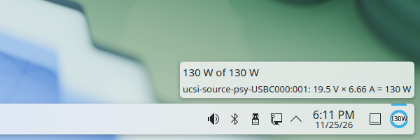
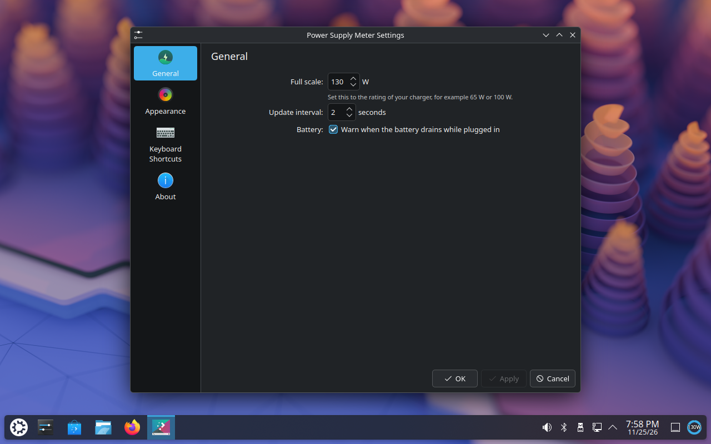

# Power Supply Meter

A KDE Plasma 6 widget that shows, as a small gauge in your panel, how much
power the connected charger can deliver: the negotiated USB-C Power Delivery
contract (`voltage_max × current_max`), not how much the laptop is using.

**Why:** a flaky Thunderbolt dock or cable can make a 130 W charger
negotiate much less than 130 W. Under heavy load the laptop then quietly
drains its battery while plugged in. With the gauge always visible in the
panel, a drop from 130 W to 60 W is noticed straight away.

| Breeze Dark | Breeze |
|---|---|
|  |  |

<details>
<summary>Settings</summary>



</details>

<!-- Regenerate with `make screenshots`; see docs/SCREENSHOTS.md. -->

## Features

- Circular gauge in horizontal and vertical panels or on the desktop.
- Tooltip and popup with each supply's voltage, current and wattage.
- Warns, with a red gauge, when the battery drains while plugged in.
- Configurable full scale (set it to your charger's rating, e.g. 65 W or 100 W)
  and update interval.
- Optional custom label font and gauge, track and text colours; by default it
  follows your Plasma theme and accent colour.
- Keyboard accessible; works with screen readers.
- No network access, no telemetry, no root privileges.

## Requirements

The widget is plain QML with no compiled code, so it is not tied to a
distribution. It needs three things:

1. **KDE Plasma 6.0 or later.** Plasma 5 is not supported. That rules out
   Kubuntu 24.04 LTS and Debian 12, which ship Plasma 5.27.
2. **Hardware and a kernel that report the charger's rating.** That means a
   `power_supply` with `online`, `voltage_max` and `current_max`. On most
   modern laptops this comes from the UCSI driver (`ucsi_acpi`,
   `ucsi-source-psy-*` devices); USB-C PD ports driven by TCPM
   (`tcpm-source-psy-*`) work too. Check yours:

   ```sh
   grep -sH . /sys/class/power_supply/*/{online,voltage_max,current_max}
   ```

   If no supply shows both `voltage_max` and `current_max`, the widget can
   only tell you that you are on external power. The drain warning still
   works.
3. **Plasma's standard QML modules:** Qt Quick, Qt.labs.platform, Kirigami,
   KCMUtils, KQuickControls, KQuickCharts and Plasma5Support. A normal
   Plasma desktop install already includes all of them, plus `/bin/sh` and
   `grep`. Only if you assembled Plasma from individual packages on Debian
   or Ubuntu might you need:

   ```sh
   sudo apt install qml6-module-qt-labs-platform qml6-module-org-kde-kcmutils \
     qml6-module-org-kde-kquickcontrols qml6-module-org-kde-quickcharts \
     qml6-module-org-kde-plasma-plasma5support
   ```

`kinfocenter` is optional; it powers the "Show Energy Information…" action.
If the panel shows an error naming a missing module instead of the gauge,
[docs/COMPATIBILITY.md](docs/COMPATIBILITY.md#if-the-widget-shows-an-error-instead-of-the-gauge)
lists the package to install.

| Distribution | Works with a standard Plasma install |
|---|---|
| Kubuntu 25.10, 26.04; KDE neon; Debian 13 | yes |
| Fedora KDE, Fedora Kinoite | yes |
| openSUSE Tumbleweed, Leap 16 | yes |
| Arch (and Manjaro, EndeavourOS, CachyOS) | yes |
| NixOS (`services.desktopManager.plasma6`), Gentoo (`plasma-meta`), Void (`kde-plasma`) | yes |
| Alpine | the widget loads, but the stock kernels lack UCSI, so no wattage is shown |
| Kubuntu 24.04, Debian 12 | no (Plasma 5) |
| Chromebooks | wattage via `voltage_max_design` (untested on hardware) |
| Apple Silicon | no wattage: the driver does not expose a rating |

Only Plasma 6.6.7 on Kubuntu 26.04 (Wayland) has actually been tested. The
other rows come from each distribution's package dependencies and kernel
configuration. [docs/COMPATIBILITY.md](docs/COMPATIBILITY.md) has the
evidence and per-distribution details.

## Installation

### From the KDE Store

Right-click the panel → **Add or Manage Widgets…** → **Get New…** →
**Download New Plasma Widgets**, search for "Power Supply Meter", or get it
from its [KDE Store page](https://store.kde.org/p/2382745).

### Manually

Download `power-supply-meter-<version>.plasmoid` from the
[releases](https://github.com/filiurskyi/plasma-applet-power-supply-meter/releases),
optionally check it against the `.sha256` file, then:

```sh
kpackagetool6 --type Plasma/Applet --install power-supply-meter-<version>.plasmoid
# later versions:
kpackagetool6 --type Plasma/Applet --upgrade power-supply-meter-<version>.plasmoid
```

No root access is needed; the widget is installed into
`~/.local/share/plasma/plasmoids/`. Then add "Power Supply Meter" to a panel.

## Configuration

Right-click the widget → **Configure Power Supply Meter…**

- **General:** full scale in watts (default 130 W), update interval (default 2 s),
  warning when the battery drains while plugged in (default on; when off,
  the tooltip and popup still mention the drain but the gauge colour and tray
  visibility do not change).
- **Appearance:** system or custom font; custom gauge, track and text colours;
  outline around the label.

Settings are stored per widget instance by Plasma, so several gauges can be
configured differently.

## Known limitations

- The value is what the charger *offers*, not what the laptop draws.
- Hardware that does not expose `voltage_max`/`current_max` shows no wattage.
- The gauge cannot show which voltage/current levels the charger supports
  overall; Linux exposes those only on some hardware.
- The drain warning relies on the battery reporting `Discharging`. The
  discharge power is shown only if the battery reports `power_now` or
  `current_now` and `voltage_now`. The warning appears after two polls
  (default 4 s), so very short drains are not shown.
- Reading sysfs needs a short-lived `grep` process every interval (default
  2 s), because neither Plasma nor UPower exposes the negotiated rating.

## Development

```sh
make doctor     # which tools are installed and how to get the rest
make link       # symlink package/ into ~/.local/share/plasma/plasmoids
make check      # everything CI runs
make package    # dist/power-supply-meter-<version>.plasmoid
```

See [docs/DEVELOPMENT.md](docs/DEVELOPMENT.md) for the full workflow,
[docs/ARCHITECTURE.md](docs/ARCHITECTURE.md) for how the widget works and
[CONTRIBUTING.md](CONTRIBUTING.md) before opening a pull request.

This repository also works as a template for new Plasma widgets: run
`make init` in a fresh copy.

## License

GPL-3.0-or-later, see [LICENSE](LICENSE). Files carry SPDX headers and the
repository follows the [REUSE](https://reuse.software/) specification.
Copyright © 2026 Andrii Filiurskyi.
